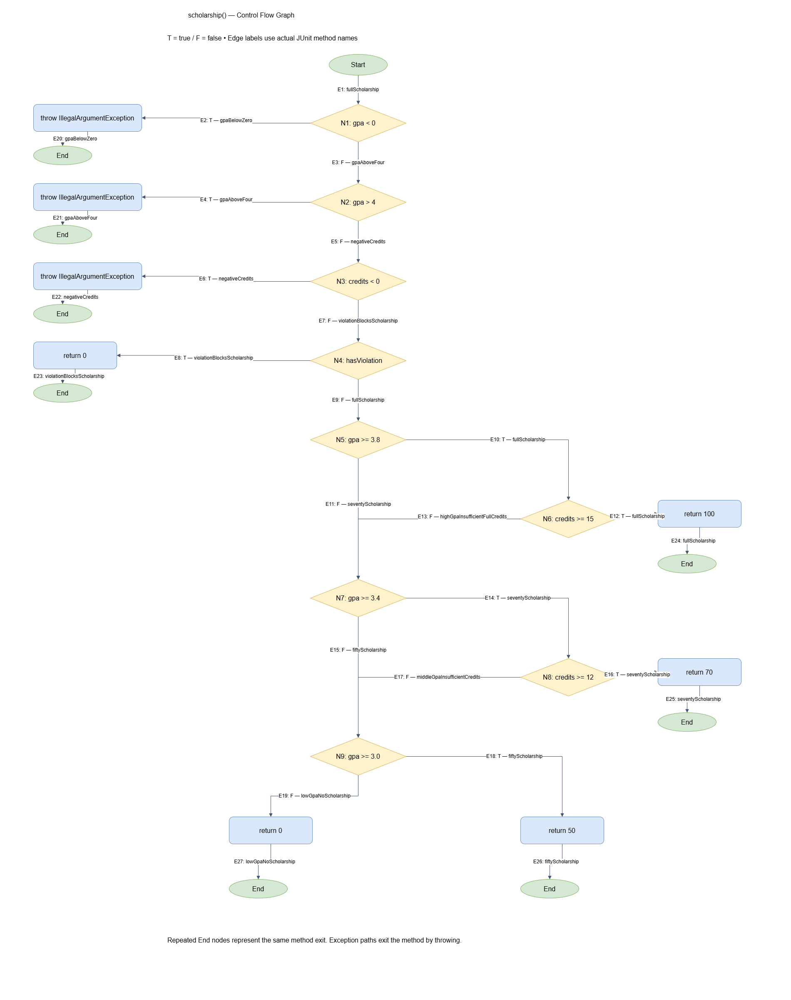

# Лаборатори 9 — Код хамралт, JaCoCo

- Оюутан: Ж.Буянхишиг
- Оюутны код: B232270114

## Ажлын орчин

```text
openjdk version "17.0.20.1" 2026-08-18
OpenJDK Runtime Environment (build 17.0.20.1+1-1-26.04-Ubuntu)
OpenJDK 64-Bit Server VM (build 17.0.20.1+1-1-26.04-Ubuntu, mixed mode, sharing)
Apache Maven 3.9.12
Maven home: /usr/share/maven
Java version: 17.0.20.1, vendor: Ubuntu, runtime: /usr/lib/jvm/java-17-openjdk-amd64
Default locale: en, platform encoding: UTF-8
OS name: "linux", version: "6.6.114.1-microsoft-standard-wsl2", arch: "amd64", family: "unix"

```

## A — Happy path тестүүд

Хэвийн урсгалын 5 тест ажилласан бөгөөд бүгд амжилттай болсон.

| Үзүүлэлт | Хамрагдсан | Хамрагдаагүй | Хамралт |
|---|---:|---:|---:|
| Line | 16 | 9 | 64.00% |
| Branch | 22 | 19 | 53.66% |

Эдгээр тоог results/jacoco-A.csv файлаас тооцсон.
Line хамралт: 16 / (16 + 9) × 100 = 64.00%.
Branch хамралт: 22 / (22 + 19) × 100 = 53.66%.

Одоогийн тестүүд буруу оролтын exception замууд болон зарим дүн,
тэтгэлгийн хувилбарыг ажиллуулаагүй тул хүрээгүй мөрүүд улаан харагдана.
Зөв оролтоор зөвхөн нэг тал нь ажилласан нөхцөлүүд шар ромботой байна.

Нотолгоо:
- results/mvn-verify-A.txt
- results/jacoco-A.csv

## B — Line болон Branch хамралт 100%

Нийт 21 тест ажиллаж, бүгд амжилттай болсон.
Тестийн тоог results/mvn-verify-B.txt файлаас авсан.

| Үзүүлэлт | Хамрагдсан | Хамрагдаагүй | Хамралт |
|---|---:|---:|---:|
| Line | 25 | 0 | 100% |
| Branch | 41 | 0 | 100% |

results/jacoco-B.csv файлд BRANCH_MISSED = 0,
LINE_MISSED = 0 болсон.

Буруу оролтын exception замууд, бүх үсгэн дүн,
сахилгын зөрчил болон кредит хүрэлцэхгүй нөхцөлүүдийг шалгасан.
gpa()-ийн switch-ийн default салааг F дүнтэй оролтоор хамруулсан.

### scholarship() функцийн CFG



Нөхцөлүүдийн богино холболтыг харуулахын тулд || болон &&
илэрхийллийн нөхцөл бүрийг тусдаа зангилаагаар дүрсэлсэн.
Ирмэгүүд дээр тухайн замыг дайрдаг бодит тестийн нэрийг тэмдэглэсэн.

## C — Давталтын заагийн тестүүд

| Оролт | Тест | Хүлээгдэж буй үр дүн |
|---|---|---|
| 0 элемент | emptyScoresRejected | IllegalArgumentException |
| null | nullScoresRejected | IllegalArgumentException |
| 1 элемент: [95] | averageOneGrade | 4.0 |
| 2+ элемент: [95, 85, 75, 65] | averageSeveralGrades | 2.5 |

Хоосон болон null оролтыг assertThrows ашиглан шалгасан.
Эдгээр оролт нь давталтад орохоос өмнө няцаагдана.

Branch хамралт 100% болсон ч давталт нэг болон олон элемент дээр
зөв тооцоолж байгааг тусад нь шалгах шаардлагатай.
Эдгээр тест хамралтын хувийг нэмэхгүй байж болох ч нийлбэр
хуримтлуулах, элементийн тоонд хуваах үйлдлийн зөв үр дүнг шалгана.

## D — Зааг утгын алдаа ба засвар

Зааг утгын 7 тест нэмсний дараа нийт 30 тестээс score60IsD
тест унасан. results/mvn-test-D-fail.txt файлд дараах алдаа бүртгэгдсэн:

```text
ScholarshipCalculatorTest.score60IsD:146 expected: <D> but was: <F>```
Спецификациар 60 оноо D байх ёстой боловч score > 60 нөхцөлөөс
шалтгаалан F буцааж байсан. Нөхцөлийг score >= 60 болгон зассан.
- Унасан тестийн commit: 56196ad
- Засварын тусдаа commit: 179ee61
- Эцсийн тестийн тоо: 30, бүгд амжилттай
- Line: 25/25 буюу 100%
- Branch: 41/41 буюу 100%
Нотолгоо:
- results/mvn-test-D-fail.txt
- results/mvn-verify-final.txt
- results/jacoco-final.csv
### Гол дүгнэлт
Branch хамралт 100% болсон ч letterGrade(60) буруу үр дүн өгч байсан.
Өмнөх тестүүд 65 болон 50 утгаар D, F салаануудыг ажиллуулсан боловч
яг 60 гэсэн заагийг шалгаагүй.
score > 60 болон score >= 60 нөхцөлүүд ижил салааны бүтэцтэй тул
хамралтын хувь энэ ялгааг илрүүлэхгүй.
score60IsD тест спецификацийн дагуу D хүлээж, F буцаасныг илрүүлсэн.
Хамралт нь кодын аль хэсэг ажилласныг хэмждэг боловч бүх оролтын
үр дүн зөв гэдгийг баталдаггүй.
Иймээс бүтцийн тестийг зааг утгын тест болон спецификацид
тулгуурласан шалгалтаар нөхөх шаардлагатай.
